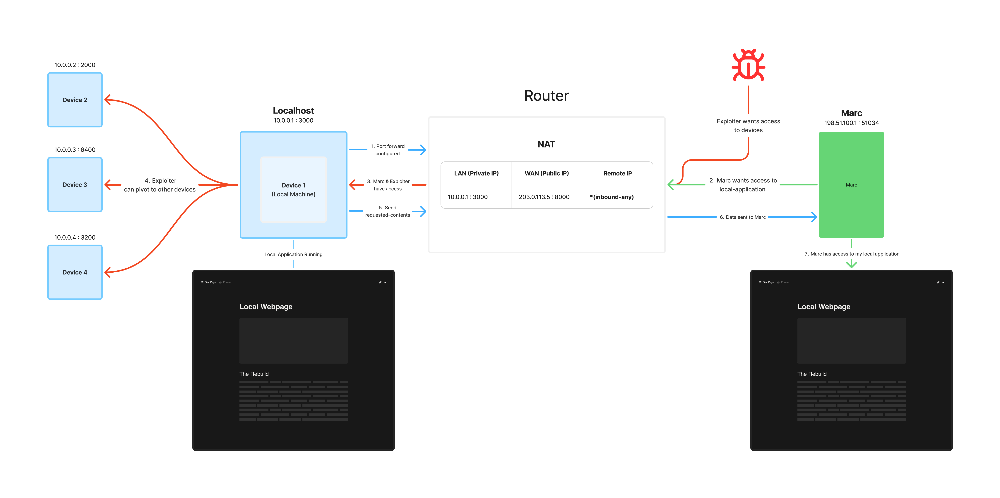

# NAT Tunnel

A from-scratch reverse tunnel in Go: expose a local server to the internet without port forwarding.

## Overview

I was building a separate application and wanted a friend to test it right away, without deploying it first. Port forwarding was the only option I could think of, but it meant manual router configuration, and I wasn't sure I could even do it on my apartment's network.

[Cloudflare Tunnel](https://developers.cloudflare.com/cloudflare-one/connections/connect-networks/) came in clutch. With one command, I had a public link to my local app, with no port forwarding needed, and my friend was able to connect and test it. I'm easily impressed, but I couldn't stop wondering how it actually worked, so I decided to build my own.

## Issues with Traditional Port Forwarding
*****Suppose my friend Marc wants to connect to my local-application, and port-scanner also wants to connect.*****

- **Pokes a hole in the router's NAT/firewall**, letting unsolicited inbound traffic through
- **Exposes your home public IP** to anyone who connects (DDoS, rough geolocation)
- **Port scanners find open ports within minutes**
- **A bug in the exposed service gives attackers a foothold on your machine**
  - From there, they can pivot to other devices on the same subnet
  - And intercept LAN traffic between those devices
